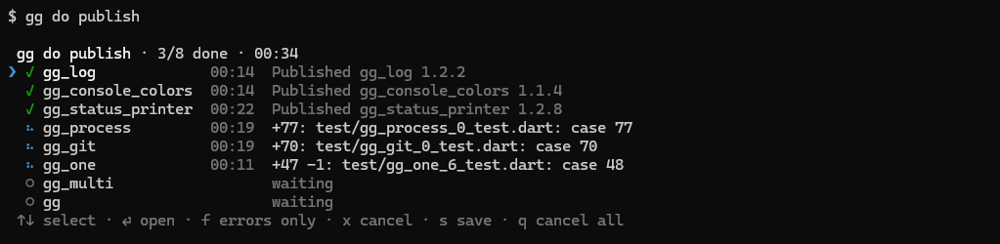
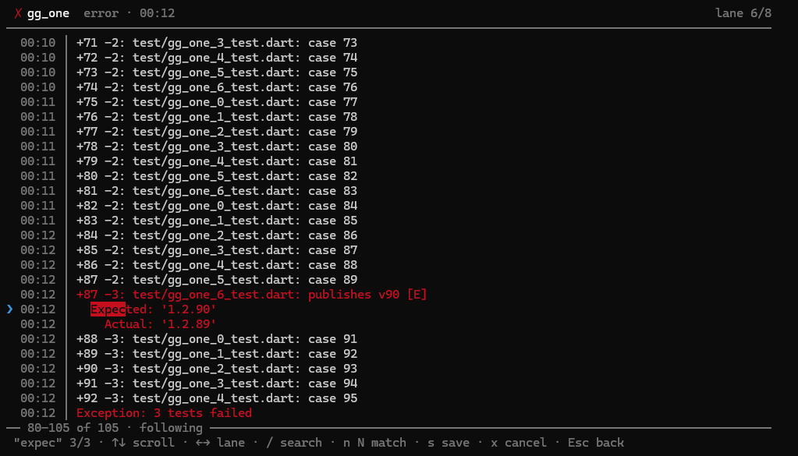
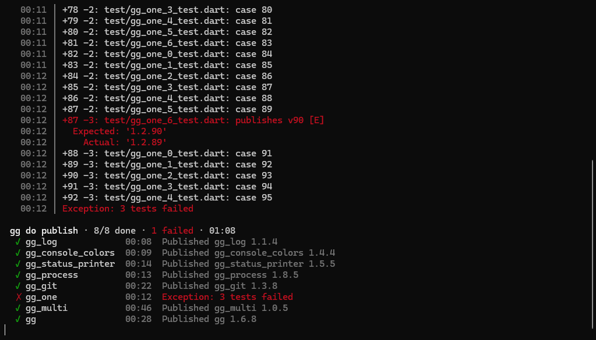

# gg_parallel_log

English | [Deutsch](README.de.md)

[](https://github.com/ggsuite/gg_parallel_log/actions/workflows/quick_check.yaml)
[](https://pub.dev/packages/gg_parallel_log)

Interactive CLI logger for parallel processes: inline overview, fullscreen
lane details, error filter, search, cancel and a plain fallback.



## Motivation

Tools like `gg` run many things at once: tests, analysis and publishing
across a dozen repositories. Written to one terminal, their output
interleaves into a wall of text, and the one line that matters, the
failure, is buried in it.

`gg_parallel_log` gives every process a lane of its own and shows them the
way the Claude Code console does:

- A compact live overview stays at the bottom of the terminal, one row per
  lane, while the scrollback above stays untouched
- Each lane opens in fullscreen with its complete output, search included
- Failed lanes are repeated at the end, so no error disappears with the
  live view
- Every lane is a plain `GgLog`, so existing code that takes a `ggLog`
  runs in parallel without a change

## Installation

```bash
dart pub add gg_parallel_log
```

## Usage

Create a log, run each task in a lane and finish the log at the end. The
lane passes its `log` wherever a `GgLog` is expected; everything a task
prints ends up in its lane as well. Taken from
[example/gg_parallel_log_example.dart](example/gg_parallel_log_example.dart),
which simulates publishing eight packages, three at a time:

```dart
final log = GgParallelLog(title: 'gg do publish');
final queue = [..._packages.keys];
for (final package in queue) {
  log.lane(package);
}

Future<void> worker() async {
  while (queue.isNotEmpty) {
    final package = queue.removeAt(0);
    try {
      await log.run(package, (lane) => _publish(lane, _packages[package]!));
    } catch (_) {
      // The lane shows the error; the other packages go on.
    }
  }
}

try {
  await Future.wait([for (var i = 0; i < 3; i++) worker()]);
} finally {
  // Restores the terminal and leaves the summary, even after a crash.
  await log.finish();
}
```

A lane logs a child process with `await lane.pipe(process)`, which also
kills the process when the user cancels the lane.

### Keys

| Where | Key | Does |
| --- | --- | --- |
| Overview | `↑` `↓` / `k` `j` | Select a lane |
| Overview | `⏎` / `→` | Open the lane in fullscreen |
| Overview | `f` | Show failed lanes only, or all again |
| Overview | `q` `q` | Cancel all running lanes |
| Both | `x` `x` | Cancel the selected lane |
| Both | `s` | Save the output of the lane to a file |
| Fullscreen | `↑` `↓` `PgUp` `PgDn` `Home` `End` | Scroll; `End` follows the output |
| Fullscreen | `←` `→` | Switch to the previous or next lane |
| Fullscreen | `/` `n` `N` | Search, jump to the next or previous match |
| Fullscreen | `Esc` | Back to the overview |
| Anywhere | `Ctrl+C` | Cancel all lanes; a second time exits |



When all lanes are done, the live view gives way to a summary. Failed
lanes come first with their last 40 lines and the path of the full log,
the result table comes last:



Without a terminal, e.g. on CI or in a pipe, the log writes each line
prefixed with its lane, followed by the same summary.

## Limitations

- It logs, it does not schedule: how many tasks run at once and in which
  order is up to the caller
- The interactive view reads stdin, which a process can listen to only
  once; tasks must not read stdin while the view is open
- Output written directly to stdout, e.g. by a child process started with
  `inheritStdio`, bypasses the lanes and breaks the view; pipe it into a
  lane instead
- Wide characters are measured with a built-in table; rare emoji may be
  off by one column

## Documentation

- [Code guide](doc/guides/code-guide.md)
- [Test guide](doc/guides/test-guide.md)
- [Development guide](doc/guides/develop-guide.md)

## Status

Before 1.0, the API may change between minor versions.

## Contributing

Follow the [development guide](doc/guides/develop-guide.md).

## License

MIT, see [LICENSE](LICENSE).
